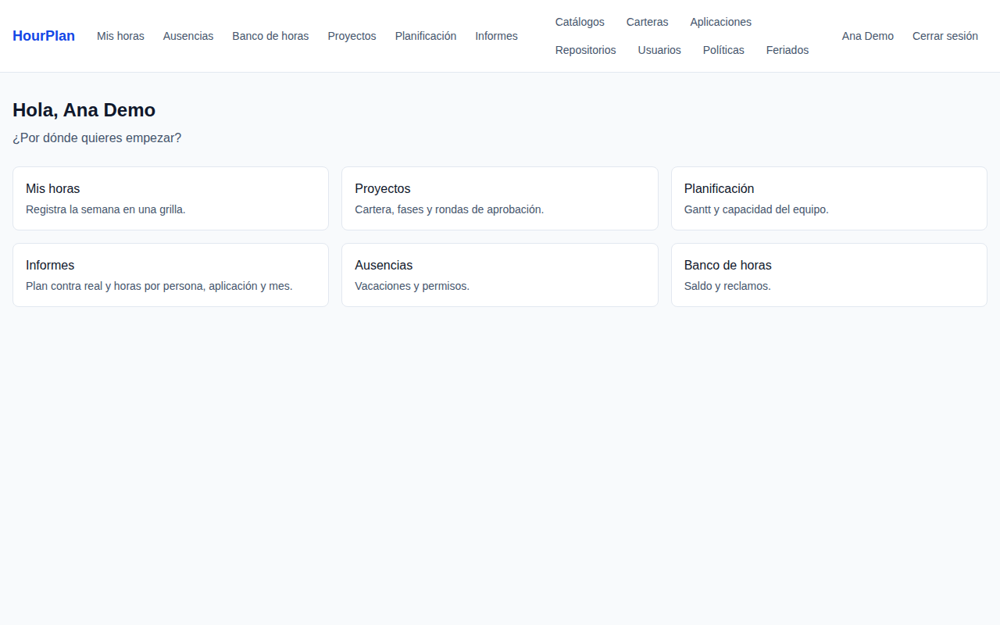
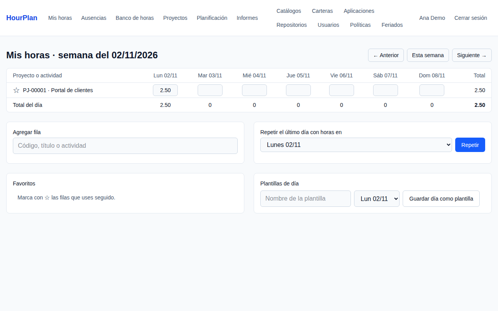
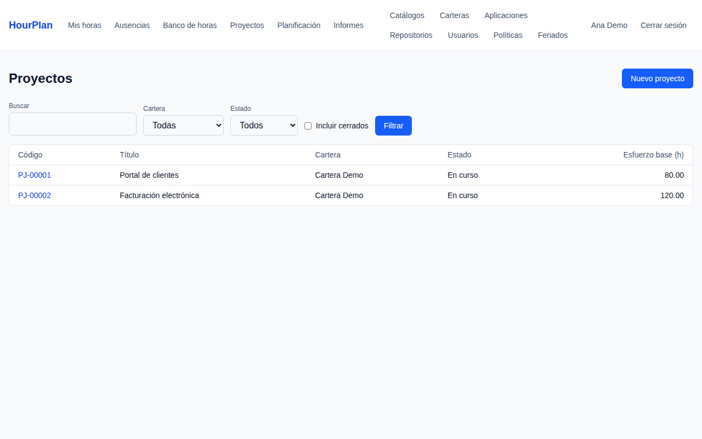
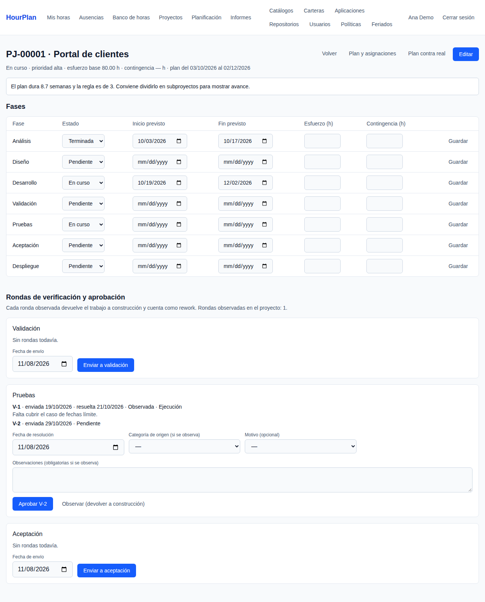
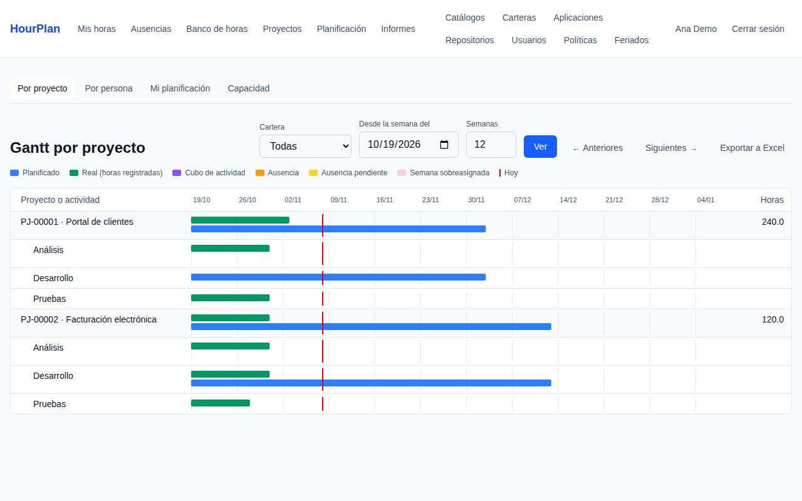
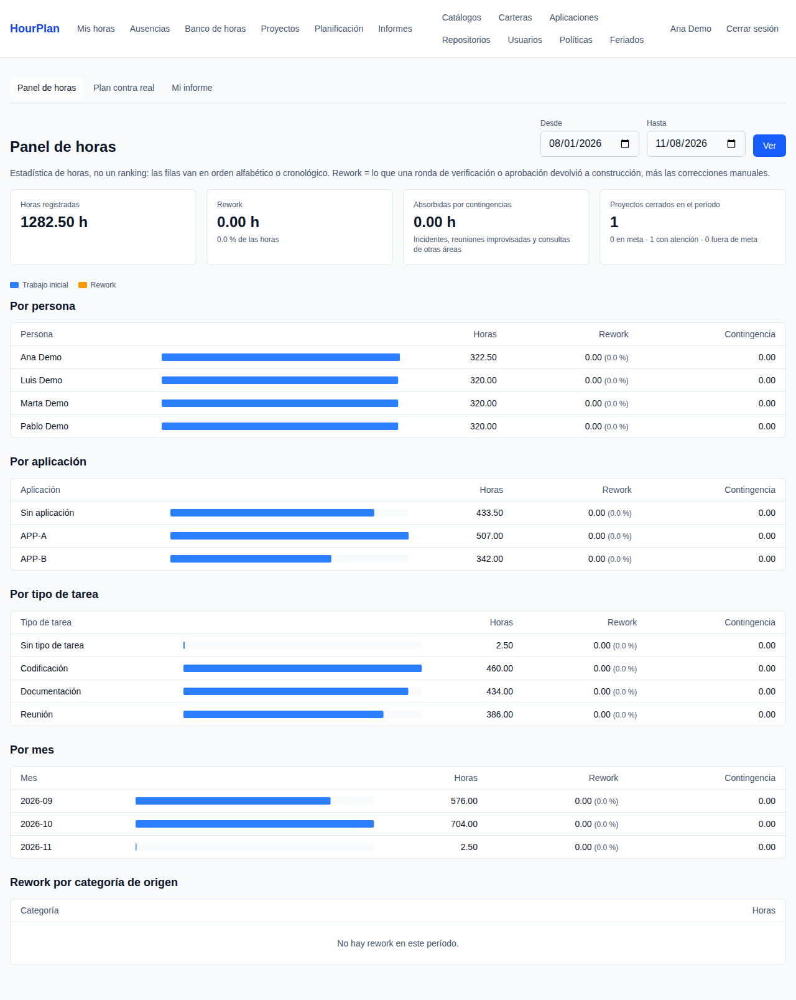
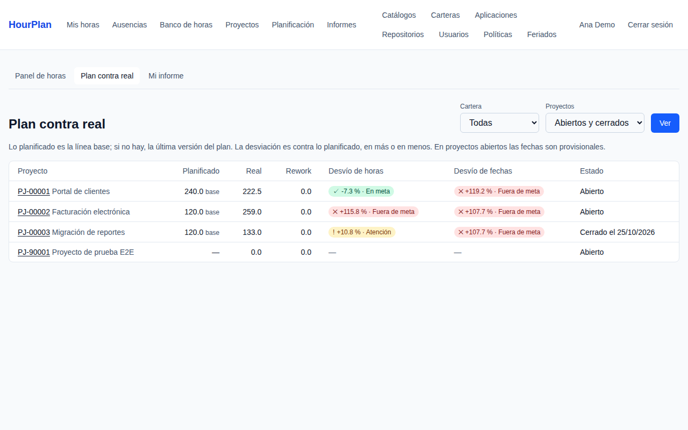
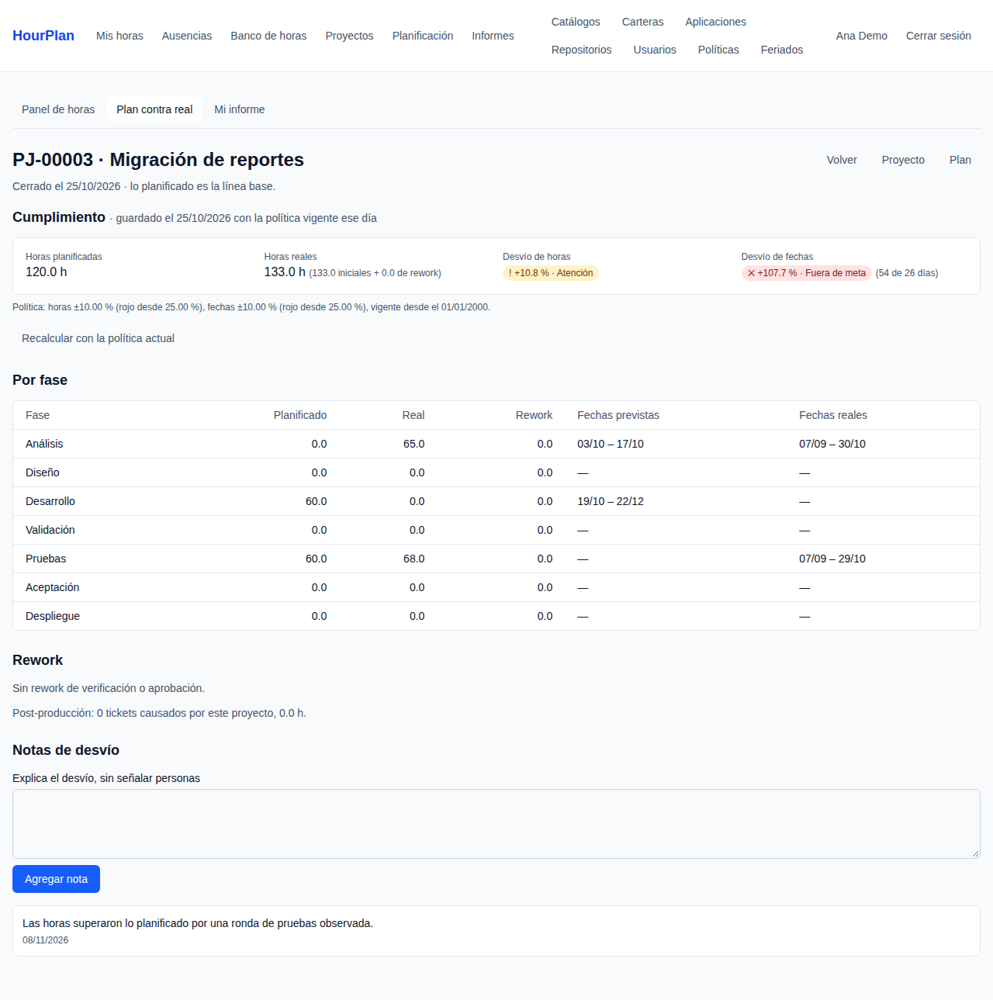

# HourPlan

Gestor liviano de cartera de proyectos, planificación por recurso, registro de horas y comparativa plan vs real. Genérico y configurable: las fases, los catálogos y las políticas son datos, no código.

> Estado: MVP. Registro de horas en grilla semanal, ausencias y banco de horas, cartera de proyectos con rondas de verificación y aprobación, planificación con línea base y Gantt, informes de plan contra real, e importación y exportación de Excel. Falta el cronómetro y las alertas.

## Stack

| Capa | Tecnología |
|---|---|
| Backend | Python 3.14, Flask 3.1, SQLAlchemy 2.1, Alembic |
| Base de datos | PostgreSQL 18 |
| Interfaz | Jinja2, Tailwind CSS 4, HTMX 2, Alpine.js 3 (alojados en la propia app, sin CDN) |
| Seguridad | Flask-Login + Argon2, CSRF, límite de intentos, CSP estricta y cabeceras seguras |
| Calidad | uv, Ruff, mypy (strict), pytest, import-linter, pip-audit, gitleaks, Trivy |
| Despliegue | Docker multi-etapa (Alpine, usuario no root, gunicorn) y Docker Compose |

## Instalación

Requisitos: Docker con Compose 2.24 o superior y GNU Make.

```bash
cp .env.example .env          # cambia SECRET_KEY antes de usarlo fuera de tu equipo
make up                       # construye, arranca y aplica las migraciones
make seed                     # catálogos, plantillas de fases y políticas iniciales
make user                     # crea la primera cuenta (asigna roles con --role admin…)
flask link-resource CORREO    # vincula esa cuenta con su recurso para registrar horas
```

Para probarla con datos ficticios en una base vacía: `make demo` (proyectos `PJ-00001…`, rondas observadas y un proyecto cerrado).

Los roles son `admin`, `pm`, `lead`, `developer` y `observer`; un usuario puede tener varios. Para cambiarlos: `flask grant-role CORREO ROL` y `flask revoke-role CORREO ROL`.

La aplicación queda en <http://127.0.0.1:8000> y la comprobación de salud en `/healthz`.

Para desarrollar con recarga automática y compilación de CSS:

```bash
make dev                      # http://127.0.0.1:8001
```

`make help` lista todos los comandos. Las variables de entorno están documentadas en [`.env.example`](.env.example).

Desarrollo sin Docker (opcional): Python 3.14, [uv](https://docs.astral.sh/uv/) y Node.js 24.

```bash
set -a && . ./.env && set +a   # exporta las variables de .env
uv sync && npm ci && npm run build
uv run alembic upgrade head
uv run flask --app hourplan seed
uv run flask --app hourplan run --debug
```

## Cómo correr las pruebas

Las pruebas usan PostgreSQL real (servicio `db` de Compose) y bloquean cualquier otra conexión de red.

```bash
make test                     # suite completa con cobertura (mínimo 80 %)
make test-fast K=login        # solo las pruebas que coinciden con K
make lint                     # Ruff, formato, mypy y contratos de arquitectura
make audit                    # vulnerabilidades conocidas en dependencias
make e2e                      # pruebas de navegador (Playwright en Docker, base descartable)
```

Para los hooks locales: `uvx pre-commit install`.

## Arquitectura

Monolito Flask organizado por features (`src/hourplan/<feature>/`): las rutas validan y delegan, los servicios contienen los casos de uso y reciben la sesión de base de datos por parámetro, y los modelos no conocen HTTP. Los contratos de [import-linter](pyproject.toml) verifican estas reglas en CI.

Modelo de datos: cada entrada de horas es una fila (múltiplos de 0,25 h); los totales, el plan contra lo real y el Gantt son consultas. Las fases son datos (plantillas con pasos de un tipo: planificación, construcción, verificación, aprobación o despliegue) y la lógica depende del tipo, no del nombre. Las políticas de jornada y de evaluación tienen fecha de vigencia y no se reescriben hacia atrás. Los cambios relevantes quedan en `audit_log`.

Una organización puede adaptar la aplicación con su propia configuración sin tocar el código: si `HOURPLAN_OVERLAY_DIR` contiene un `seed.toml`, `make seed` lo usa en lugar de la [semilla neutra](src/hourplan/setup/seed.toml). Del mismo modo, `import_mapping.toml` ajusta cómo se leen los Excel.

### Importar horas desde Excel

```
flask import-hours archivo.xlsx   # una fila por tarea y una columna por día
flask import-report <lote>        # hallazgos de calidad de datos
flask import-revert <lote>        # deshace el lote completo
```

Repetir el mismo archivo se rechaza y las filas ya guardadas se omiten. Con Docker, monta el archivo en el contenedor (`docker compose run --rm -v "$PWD/datos":/datos:ro web flask import-hours /datos/archivo.xlsx`).

## Capturas

Con datos de demostración (`make e2e` las regenera).

| | |
|---|---|
|  |  |
|  |  |
|  |  |
|  |  |

## Licencia

[GNU Affero General Public License v3.0](LICENSE) © 2026 [susananzth](https://github.com/susananzth).
